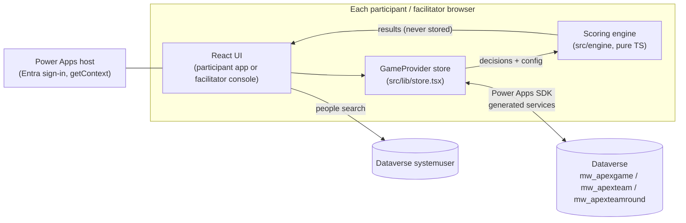

# Apex: The Five Loop Investment Game

A facilitated leadership simulation built as a **Power Apps Code App**. Teams run a $2.5B
professional-services enterprise for four rounds, spend two limited budgets (investment capital
and leadership capacity) across initiatives, record their reasoning, and see the consequences
when the facilitator reveals each round. The score, the **System Health Index**, is a rescaled
geometric mean of five interdependent loops (Market, Value, Capability, Control, Cash), so one
weak loop drags the whole system down.

> **Engineer handbook.** This README is the technical reference for maintaining, deploying, and
> troubleshooting the app. A formatted copy for non-engineers lives on SharePoint:
> **[Apex Simulation engineer handbook (SharePoint)](#)** _(link to be added)_.

---

## Contents

1. [At a glance](#1-at-a-glance)
2. [What the app does](#2-what-the-app-does)
3. [Architecture](#3-architecture)
4. [Repository layout](#4-repository-layout)
5. [Data model (Dataverse)](#5-data-model-dataverse)
6. [Scoring engine](#6-scoring-engine)
7. [Game flow, roles, and permissions](#7-game-flow-roles-and-permissions)
8. [Local development](#8-local-development)
9. [Testing](#9-testing)
10. [Deployment](#10-deployment)
11. [Common maintenance tasks](#11-common-maintenance-tasks)
12. [Troubleshooting](#12-troubleshooting)
13. [Known limitations and risks](#13-known-limitations-and-risks)
14. [Reference](#14-reference)

---

## 1. At a glance

| Item | Value |
|---|---|
| App | **Apex Simulation** (Power Apps Code App) |
| App ID | `8caf5180-7c95-4c60-a00a-2d6085faed19` |
| Environment | **Enterprise Architecture Roadmap Dev** |
| Environment ID | `b242d458-565e-e01e-b2f0-00fe9b365e15` |
| Org URL | `https://org8c828ba2.crm.dynamics.com/` |
| Solution | `ApexSimulation` (publisher `ModernWorkplace`, prefix `mw`) |
| Tables | `mw_apexgame`, `mw_apexteam`, `mw_apexteamround` (+ read-only `systemuser`) |
| Security roles | `ApexPlayer`, `ApexFacilitator`, `ApexObserver` |
| Play URL | `https://apps.powerapps.com/play/e/b242d458-565e-e01e-b2f0-00fe9b365e15/app/8caf5180-7c95-4c60-a00a-2d6085faed19` |
| Repo | `https://github.com/andrew-ricchiuto-cla/code-app-apex` (branch `master`) |
| Stack | React 19, TypeScript 5.9, Vite 7, Tailwind CSS v4, shadcn/ui (Radix), Recharts, Vitest |
| Tooling | Node 24, Power Apps CLI `@microsoft/power-apps-cli` 1.1 (`npx pa`) |
| Model source | *Five_Loop_Investment_Game_Simulation_Oct 7.xlsx* (Yassir Karam) |
| Owner | Andrew Ricchiuto (Enterprise Systems) |

Status: **pre-production**. Deployed only to the Dev environment.

---

## 2. What the app does

### Two surfaces, one app

The landing page offers two doors:

- **Participants** join a game, pick their team, and play.
- **Facilitators** create and run games (only the game's creator and named co-facilitators can
  open a game's console).

Outside the Power Apps host (for example `npm run dev`), both doors use a **local sandbox**
stored in the browser, which is useful for rehearsal and development.

### Participant experience

| Area | What it does |
|---|---|
| **This round** | Follows the round phase: briefing, decide, waiting, reveal. |
| Decide step 1: **Initiatives** | One `Off / Focused / Accelerated` control per initiative, with costs shown as 🪙 capital and ⚡ leadership capacity. Sticky budget cards show what is left. Options that would exceed a budget are greyed and explain why when clicked. Max 4 initiatives. |
| Decide step 2: **Enterprise choices** | Distribution posture (Protect / Balance / Moderate), targeted workforce reduction, and the Round 4 strategic option (Round 4 only). |
| Decide step 3: **Decision record** | Eight reasoning fields with guidance (Diagnosis, Learning since the prior round, Decision hypothesis, Leading indicator, Intentionally exposed, Reconsider/stop/scale trigger, Minority view, Stakeholder message). Required fields block submission. |
| Decide step 4: **Review & submit** | Summary plus hard checks (budget, intensity, duplicates, missing required fields). Only the team **captain** can submit. |
| **Reveal** | System Health Index with change and band, rank, the five loops before/after, and business outcomes. Nothing is shown until the facilitator reveals. |
| **Our company** | Company record by round (with a change column between rounds) and a decisions-by-round table. |
| **Leaderboard** | All teams, revealed rounds only. |
| **How it works** | Primer on the loops, budgets, delays, events, and designed tensions. |
| **🍋 Lemonade Stand walkthrough** | Optional 8-step practice round explaining the flow. Opens from the header, How it works, the landing page, or a shared `?tour=1` link. |

### Facilitator console (tabs)

| Tab | What it does |
|---|---|
| **Run session** | Round and phase stepper with one primary action per phase, submission tracker (with Unlock), Round 4 evidence-review rulings, and facilitator-only live standings. **Present** opens a projector view. |
| **Teams** | Per-team tabs: decisions, rulings, index, and the full engine trace ("Under the hood"). |
| **Results** | Leaderboard for any round, weakest loop by team, debrief prompts, **decision records** (by question or by team), company record, decisions by round. |
| **Model settings** | Every coefficient, band, initiative, event, and realism rule. **View-only until Edit**; Save and Cancel both confirm. Saving re-scores every team, including revealed rounds. |
| **Game setup** | Game name, **team rosters** (Teams-style people picker over `systemuser`) with ★ captain, co-facilitators, and (sandbox only) export, import, and reset. |

---

## 3. Architecture



Key design decisions:

- **Inputs are stored, results are computed.** Dataverse holds only the game config, round clock,
  rosters, each team's per-round decisions, and facilitator rulings. Every device recomputes all
  results with the engine on every render. A facilitator coefficient change therefore re-scores
  the whole game everywhere within one poll cycle, and there is no stored score to drift.
- **Optimistic local state with background sync.** Edits apply instantly in the browser, writes to
  Dataverse are debounced (800 ms), and every device polls the full game every 5 s and merges remote
  changes. Rows the local device is editing are protected for 2.5 s after their write lands.
- **No custom backend.** No Azure resources, servers, or custom APIs. All data access goes through
  the Power Apps SDK and the signed-in user's Dataverse permissions.
- **Generated data layer.** `src/generated/**` and `.power/schemas/**` are produced by the Power
  Apps CLI from the Dataverse metadata. Do not edit them by hand.

---

## 4. Repository layout

```
├── power.config.json           Code App manifest: app ID, environment ID, data sources
├── .power/schemas/             Generated Dataverse schemas (committed; required to build)
├── scripts/
│   ├── extract_golden.py       Regenerates engine test fixtures from the workbook
│   └── create-dataverse-schema.ps1   Idempotent Dataverse table/column/role setup
├── docs/                       Local only (gitignored): reference workbook
└── src/
    ├── App.tsx                 Session routing: landing, participant app, or facilitator console
    ├── index.css               Theme tokens (CLA palette), global pointer-cursor rules
    ├── engine/                 Scoring engine (pure TypeScript, no React)
    │   ├── types.ts            Domain model, EngineConfig, CONFIG_VERSION
    │   ├── defaultConfig.ts    All coefficients from the Oct 7 workbook
    │   ├── engine.ts           computeRound / simulateTeam
    │   ├── engine.test.ts      Golden + validation tests
    │   └── __fixtures__/oct7-golden.json   Workbook-calculated expected values
    ├── lib/
    │   ├── store.tsx           GameProvider: state, reducer, Dataverse sync, polling, merge
    │   ├── dataverse-store.ts  Load/create/write games via generated services
    │   ├── game.ts             Round phases, facilitator rulings, visibility rules
    │   ├── session.ts          Which game/role/team this browser is in (localStorage)
    │   ├── user.ts             Signed-in user from the Power Apps host
    │   ├── people.ts           systemuser search, captain/membership rules
    │   ├── checks.ts           Pre-submit validation messages
    │   ├── content.ts          Copy: decision-record fields and guidance, primers, prompts
    │   ├── display.ts          Loop rows, baseline snapshot, ranking helpers
    │   ├── tour.tsx, tour-link.ts   Lemonade walkthrough provider and ?tour=1 links
    │   └── sticky-header.ts    Publishes header height as --app-header-h
    ├── player/                 Participant app (folder name predates the "Participant" rename)
    │   ├── player-app.tsx      Shell, header, tabs, phase routing, captain gate
    │   ├── decide.tsx          Initiatives, enterprise choices, decision record, review
    │   └── views.tsx           Briefing, reveal, leaderboard, company record, primer
    ├── facilitator/            Facilitator console tabs
    │   ├── console.tsx         Shell, header tabs, facilitator access gate
    │   ├── run-session.tsx     Phase stepper, tracker, rulings, live standings
    │   ├── teams.tsx           Team drill-in and engine trace
    │   ├── results.tsx         Leaderboard, debrief, decision records
    │   ├── model-settings.tsx  Coefficient editors with Edit/Save/Cancel
    │   ├── setup.tsx           Rosters, captains, co-facilitators, data
    │   └── present.tsx         Projector view
    ├── components/             Shared UI (people picker, lemonade tour, under-the-hood, ui/*)
    └── generated/              Generated Dataverse models and services (do not edit)
```

---

## 5. Data model (Dataverse)

All tables are **user-owned** and live in the `ApexSimulation` solution. Foreign keys are plain
text columns (`mw_gameid`, `mw_teamkey`) rather than lookups, for simplicity of the generated
client. Rich data is stored as JSON in memo columns.

### `mw_apexgame` (one row per game)

| Column | Type | Contents |
|---|---|---|
| `mw_name` | Text | Game name |
| `mw_currentround` | Whole number | 1 to 4 |
| `mw_roundphase` | Whole number | `0` Briefing, `1` Decisions open, `2` Submissions closed, `3` Results revealed |
| `mw_configjson` | Memo (JSON) | Full `EngineConfig` (all coefficients). Must have `configVersion: 2` |
| `mw_facilitatorsjson` | Memo (JSON) | `string[]` of lower-cased UPNs allowed to open the console |
| `mw_underhood` | Yes/No | Show the engine trace in the facilitator Teams tab |

### `mw_apexteam` (one row per team)

| Column | Type | Contents |
|---|---|---|
| `mw_name` | Text | Team display name |
| `mw_gameid` | Text | Parent `mw_apexgameid` |
| `mw_teamkey` | Text | Stable key, e.g. `team-1` |
| `mw_sortorder` | Whole number | Display order |
| `mw_membersjson` | Memo (JSON) | `TeamMember[]`: `{ id, upn, name, email, title? }` |
| `mw_captainupn` | Text (320) | Lower-cased UPN of the captain. Empty = open team |

### `mw_apexteamround` (one row per team per round, created with the game)

| Column | Type | Contents |
|---|---|---|
| `mw_gameid`, `mw_teamkey`, `mw_round` | Text, Text, Whole number | Identity |
| `mw_decisionsjson` | Memo (JSON) | `RoundDecisions`: initiatives, distribution, workforce, strategic option, narrative (decision record) |
| `mw_submitted` | Yes/No | Locked by the captain's Submit |
| `mw_facilitatorjson` | Memo (JSON) | `FacilitatorRuling`: Round 4 evidence trigger and custom-action pricing |

### `systemuser` (read-only)

Used by the people picker. The query returns enabled interactive users (`isdisabled eq false and
accessmode eq 0`) whose full name, first name, last name, or email starts with the search text.

### Security roles

| Role | Privileges on the three `mw_apex*` tables |
|---|---|
| `ApexPlayer` | Create, Read, Write (Global) |
| `ApexFacilitator` | Create, Read, Write (Global) |
| `ApexObserver` | Read (Global) |

Users also need the app shared with them (`npx pa app share`). System Administrators already
have table access.

> Older tables from the v1 app (`mw_simulation`, `mw_team`, `mw_teamsubmission`, and others) also
> exist in the solution. **The current app does not use them.**

---

## 6. Scoring engine

`src/engine/` is a faithful TypeScript port of the **Engine** tab of the Oct 7 workbook. It has no
React or Dataverse dependencies.

- `computeRound(config, input)` computes one team-round in stages: resources, then execution,
  change, and repeat-return factors, then immediate and lagged effects, then events (pre-event
  readiness, prior preparation versus same-round credit, response-reserve mitigation), then loop
  states, growth, cash and capital renewal, raw health, the final-round terminal blend, and the
  index.
- `simulateTeam(config, decisions[])` chains rounds, carrying state, lagged effects, repeat
  history, and capital forward.
- Every number lives in `EngineConfig` (`defaultConfig.ts`), so facilitators can tune the model
  without code changes.
- Comments in `engine.ts` reference workbook columns (for example `AY` = Event M) to make
  side-by-side validation easier.

**Facilitator rulings flow into scoring** through `effectiveDecisions()` in `src/lib/game.ts`,
which merges a team's decisions with the facilitator's Round 4 evidence ruling (and custom-action
pricing, currently disabled).

**Intentional differences from the workbook** (all configurable in Model settings):

- The workbook hard-codes event base values and ignores its own Control_Panel "Enabled" flags for
  Rounds 2 and 3. The app reads both from config.
- The workforce action's Control/OC lag applies only to the terminal projection, matching the
  workbook. `workforceAction.applyControlOcLagInPlay` can apply it in play instead.

**Config versioning.** `CONFIG_VERSION` in `types.ts` is `2`. Games whose stored config has a
different version will not load ("built for an earlier version of the model and has been
retired"). Bump it only when the config shape changes in a non-backward-compatible way.

---

## 7. Game flow, roles, and permissions

### Round phases

```
Briefing (0) ─► Decisions open (1) ─► Submissions closed (2) ─► Results revealed (3) ─► next round Briefing
```

| Phase | Participants see | Facilitator does |
|---|---|---|
| Briefing | Scenario and resources, no editing | Brief the room; open decisions |
| Decisions open | The decide flow (captain edits; teammates read-only) | Watch the tracker; unlock if needed |
| Submissions closed | Locked choices, "waiting for reveal" | Round 4: rule on each team's evidence trigger; then reveal |
| Results revealed | Reveal, leaderboard, company record | Debrief; start the next round |

A round is "revealed" to participants when it is the current round in phase 3, or any earlier
round (`isRevealed()` in `src/lib/game.ts`). Unsubmitted drafts are still scored at reveal.

### Who can do what

| Check | Where enforced | Rule |
|---|---|---|
| Open a game's facilitator console | `facilitator/console.tsx` | Signed-in UPN is in `mw_facilitatorsjson` |
| Create a game | Landing page | Any signed-in user; the creator becomes its first facilitator |
| Join a team | `components/start-screen.tsx`, `lib/people.ts` | Teams with a roster accept only their members; teams with no roster are open |
| Edit and submit a team's decisions | `player/player-app.tsx` (`canEditTeam`) | Only the captain; if no captain is set, any member |
| See other teams' decision records and unrevealed scores | Facilitator console only | Never shown in the participant app |

> **Important:** these checks are enforced **in the app UI**, not by Dataverse row-level
> security. See [Known limitations](#13-known-limitations-and-risks).

### Feature flags and switches

| Switch | Location | Default |
|---|---|---|
| Custom actions (participant proposals priced by the facilitator) | `CUSTOM_ACTIONS_ENABLED` in `src/lib/game.ts` | `false` |
| Engine trace in facilitator Teams tab | Game setup toggle (`mw_underhood`) | On |
| Workforce C/OC lag in play | Model settings | Off (workbook parity) |
| Terminal blend, Moderate credibility, repeat factors | Model settings, Realism & scoring | Workbook values |

---

## 8. Local development

Prerequisites: Node 24 (Node 20+ should work), npm, and access to the EA Roadmap Dev environment
for anything that touches Dataverse.

```bash
git clone https://github.com/andrew-ricchiuto-cla/code-app-apex.git
cd code-app-apex
npm ci
npm run dev          # Vite dev server
```

- Opened directly in a browser (`http://localhost:5173`), the app cannot reach the Power Apps
  host. After about 3 seconds both doors switch to the **local sandbox** (browser localStorage).
  This covers nearly all UI work.
- To run locally **against Dataverse**, use the "Local Play" URL that the Power Apps Vite plugin
  prints when `npm run dev` starts
  (`https://apps.powerapps.com/play/e/<envId>/a/local?_localAppUrl=...`). It loads your local
  build inside the Power Apps host with your identity.

Useful scripts:

| Command | Purpose |
|---|---|
| `npm run dev` | Dev server with hot reload |
| `npm test` | Engine tests (Vitest) |
| `npx tsc -b` | Type-check |
| `npx eslint src --ignore-pattern "src/components/ui/**"` | Lint app code (the shadcn `ui/` folder has upstream fast-refresh warnings) |
| `npm run build` | Type-check and production build to `dist/` |

---

## 9. Testing

- **Engine (automated):** `npm test` runs 33 tests.
  - **Golden tests:** six scenario teams over four rounds. For every team-round, every Engine
    column computed by the workbook is compared with the engine's output to 9 decimal places.
    Scenarios cover repeat returns, prior versus same-round event credit, workforce cuts, Moderate
    credibility, overload, the AI-offer readiness gate, custom actions, the terminal blend, and
    evidence review.
  - **Validation tests:** intensity mismatch, duplicates, over capital or leadership capacity,
    early strategic option, initiative limit, evidence review.
- **Regenerating fixtures** after a workbook change:
  1. Put the workbook at `docs/Five_Loop_Investment_Game_Simulation_Oct 7.xlsx` (gitignored).
  2. `pip install formulas openpyxl`
  3. `python scripts/extract_golden.py`, which rewrites `src/engine/__fixtures__/oct7-golden.json`
  4. `npm test`. Any failures show exactly which column and round now differ.
- **UI:** no automated UI tests. Changes have been verified manually in the local sandbox.
  Recommended smoke test before a release:
  1. Facilitator: create a game, add a roster with a captain, open Round 1.
  2. Participant (captain): select initiatives, complete the decision record, submit.
  3. Participant (non-captain): confirm read-only view.
  4. Facilitator: close, reveal, check Results and decision records; run through Round 4 including
     the evidence ruling.

---

## 10. Deployment

Deployment pushes the built bundle to the existing app ID in `power.config.json`.

```bash
npx pa auth login            # browser sign-in (device-code sign-in is blocked in this tenant)
npx pa auth status           # confirm the account
npm test && npm run build
npx pa app push --non-interactive
git push                     # keep GitHub in sync with what is deployed
```

Sharing the app with new users (play access):

```bash
npx pa app share --principal "first.last@claconnect.com,other.person@claconnect.com" --access play
```

Participants also need a Dataverse role that grants table access (`ApexPlayer`), unless they are
System Administrators.

**There is no CI/CD pipeline yet.** Production deployment should go through a managed solution and a
test environment (see [Known limitations](#13-known-limitations-and-risks)).

---

## 11. Common maintenance tasks

### Change a coefficient for one game

Facilitator console, **Model settings**, **Edit model**, change values, **Save changes**, confirm.
This re-scores every team in that game immediately, including revealed rounds.

### Change the default model for new games

Edit `src/engine/defaultConfig.ts`, run `npm test` (golden tests will flag differences from the
workbook; update fixtures if the workbook changed too), then deploy. Existing games keep their own
stored config.

### Update participant-facing wording

- Decision-record labels, summaries, guidance, placeholders, and order: `NARRATIVE_FIELDS` in
  `src/lib/content.ts`.
- Primers, tensions, debrief prompts, distribution descriptions: also `src/lib/content.ts`.
- Lemonade walkthrough: `src/components/lemonade-tour.tsx`.
- Round themes and events: `roundThemes` in `defaultConfig.ts`.

### Add or change a Dataverse column

1. Create the column in the environment (maker portal or `scripts/create-dataverse-schema.ps1`).
2. Regenerate the data layer: `npx pa app refresh data-source` (or `--name <source>`).
3. Commit `.power/schemas/**` and `src/generated/**`.
4. Read and write it in `src/lib/dataverse-store.ts`, and merge it in `src/lib/store.tsx`.

### Rebuild the schema in a new environment

```powershell
az login --allow-no-subscriptions
./scripts/create-dataverse-schema.ps1 -OrgUrl https://<org>.crm.dynamics.com -Solution ApexSimulation
```

The solution and the three security roles must exist first. Then add the data sources with
`npx pa app add data-source --connector dataverse --table <logicalname>` and update
`power.config.json` for the new environment and app.

### Clear game data

Games can be deleted from the Dataverse tables (maker portal or Web API). Delete
`mw_apexteamround`, then `mw_apexteam`, then `mw_apexgame`. Deletion is permanent.

### Re-enable custom actions

Set `CUSTOM_ACTIONS_ENABLED = true` in `src/lib/game.ts`, deploy, and test the facilitator pricing
queue on Run session.

---

## 12. Troubleshooting

### Build and tooling

| Symptom | Cause | Fix |
|---|---|---|
| `Cannot find module '../../../.power/schemas/appschemas/dataSourcesInfo'` | `.power/` missing | Pull latest (it is committed) or run `npx pa app refresh data-source` |
| `pa app push` / `refresh` fails with `AADSTS700003: Device object was not found` | Stale cached Power Apps CLI credentials | `npx pa auth logout`, then `npx pa auth login` |
| `pac code add-data-source` says no active environment | Legacy `pac` CLI profile issue | Use the npm CLI instead: `npx pa app add data-source --connector dataverse --table <name>` |
| Creating a Dataverse column right after a table fails with `0x80040216` | Metadata lock after table creation | Wait about 30 s and retry (the schema script already waits) |
| Lint errors in `src/components/ui/*` | Upstream shadcn files export helpers alongside components | Expected; lint `src` excluding `ui/` |
| Vite warns that a chunk exceeds 500 kB | Single bundle | Expected and harmless today; code-split if load time becomes an issue |

### Runtime

| Symptom | Likely cause | What to check |
|---|---|---|
| Landing page stuck on "Connecting…" | Power Apps host context did not resolve | Hard refresh. Outside the host it falls back to the sandbox after about 3 s. In the host, confirm the user can open other Power Apps |
| Landing page shows only the sandbox in the deployed app | `getContext()` returned nothing | Confirm the app was opened from the Power Apps play URL, not `dist/index.html` |
| "This game was built for an earlier version of the model and has been retired" | Game's stored config is not `configVersion` 2 | Create a new game (old games cannot be migrated) |
| "Facilitator access required" | User's UPN is not in `mw_facilitatorsjson` | Game setup, Facilitators: add their work email (UPN, lower-cased) |
| Participant cannot select their team (greyed) | Team has a roster that does not include them | Add them in Game setup, Teams. The landing page also says "You aren't on a team roster" |
| Participant sees "X is entering your team's decisions" | They are not the captain | Expected. Change the captain (★) in Game setup if needed |
| Sync badge shows **Sync error** or a "Save failed" toast | Dataverse write failed (permissions, throttling, network) | Check the user has `ApexPlayer` (or another role with table access); look at the browser network tab for the failing request. The change is kept locally and retried on the next edit |
| Another device's change does not appear | Polling delay or a row protected while being edited locally | Wait about 5 s. Changes the local device made within the last 2.5 s win locally until the next poll |
| Two people overwrote each other's decisions | Last write wins per team-round row | Use captains; only one person should edit a team's decisions |
| People picker finds nobody | User is not in the environment, is disabled, or is non-interactive | Confirm the person exists as an enabled interactive user in EA Roadmap Dev. Search needs 2+ characters |
| People picker says "Type an email and press Enter" | Running in the sandbox (no directory) | Expected outside the Power Apps host |
| Scores look wrong | Model changed, or rulings not set | Facilitator Teams tab, "Under the hood" trace shows every stage. Compare with the workbook Engine tab using the column references in `engine.ts` |
| Round 4 status "EVIDENCE REVIEW REQUIRED" | Facilitator has not ruled | Run session, Facilitator rulings: mark "Trigger met" or "Not met" |
| `?tour=1` link does not open the walkthrough | The query parameter is not passed through by the host | Open the walkthrough from the header instead. Check `tourRequested()` in `src/lib/tour-link.ts` |
| Sticky budget cards overlap the header | `--app-header-h` not set | Check `useStickyHeader` is attached to the header element (`src/lib/sticky-header.ts`) |

### Inspecting data directly

Read a game's raw rows with the Dataverse Web API:

```powershell
$org = "https://org8c828ba2.crm.dynamics.com"
$t = az account get-access-token --resource $org --query accessToken -o tsv
$h = @{ Authorization = "Bearer $t"; Accept = "application/json" }
Invoke-RestMethod "$org/api/data/v9.2/mw_apexgames?`$select=mw_name,mw_currentround,mw_roundphase,mw_facilitatorsjson" -Headers $h
Invoke-RestMethod "$org/api/data/v9.2/mw_apexteamrounds?`$filter=mw_gameid eq '<gameId>'&`$select=mw_teamkey,mw_round,mw_submitted,mw_decisionsjson" -Headers $h
```

### Resetting a browser

Session and sandbox state live in `localStorage`:

| Key | Contents |
|---|---|
| `apex-session-v2` | Which game, role, and team this browser is in |
| `apex-five-loop-game-v2` | Local sandbox game |

Clearing them returns the browser to the landing page (shared game data in Dataverse is unaffected).

---

## 13. Known limitations and risks

| Area | Limitation | Recommended action |
|---|---|---|
| **Security** | Facilitator access and captain-only editing are enforced in the UI. `ApexPlayer` has org-wide create/read/write on the three tables, so a technical user could modify rows directly through the API. | Acceptable for a facilitated training exercise. For production, consider team ownership with row-level security, or explicitly accept the risk |
| **Concurrency** | Last write wins per row; no optimistic concurrency (ETag) checks | Captain-only editing mitigates. Add ETags if multiple editors are ever needed |
| **Scale** | Each device polls about 3 queries every 5 s. Not load-tested | Well within per-user Dataverse limits, but run a multi-device dry run before production |
| **Testing** | Engine is fully tested; UI is manually tested only | Add Playwright smoke tests if the app grows |
| **ALM** | Deployed directly to a Dev environment with `pa app push`; no managed solution or pipeline | Export a managed solution; deploy through Test to Production |
| **Licensing** | Code apps using Dataverse likely require Power Apps Premium per user | Confirm with the Power Platform team before scaling |
| **Accessibility** | Keyboard support and ARIA roles in key controls; no formal audit | Run an accessibility review |
| **Data retention** | Decision records are free text stored indefinitely | Agree on a retention policy (for example, purge games after debrief) |
| **Legacy tables** | v1 tables remain in the solution | Remove once confirmed unused |
| **Knowledge concentration** | One primary maintainer | Use this document; assign a second maintainer |

---

## 14. Reference

### Glossary

| Term | Meaning |
|---|---|
| **Loops** | Market (M), Value (V), Capability (65% depth K + 35% fluidity F), Control (C), Cash |
| **EC / OC** | Employee and Owner confidence: signals, not direct health inputs. Low OC penalizes next-round Control |
| **LC** | Leadership / change capacity, the second budget. Shown as ⚡ |
| **Response reserve** | Unused LC carried forward that softens the next round's negative events |
| **System Health Index** | `clamp(0, 100, 50 + 1.25 × (raw − 50))`, where raw is the geometric mean of the five loops; Round 4 blends 70% current with 30% projected terminal state |
| **Decision record** | The eight reasoning fields a team completes before submitting (formerly "Rationale") |
| **Captain** | The one team member who can edit and submit |
| **Ruling** | Facilitator-only input on a team-round (Round 4 evidence trigger; custom-action pricing) |

### Key constants

| Constant | Value | File |
|---|---|---|
| Poll interval | 5000 ms | `src/lib/store.tsx` (`POLL_MS`) |
| Write debounce | 800 ms | `src/lib/store.tsx` (`DEBOUNCE_MS`) |
| Local-edit protection after write | 2500 ms | `src/lib/store.tsx` (`DIRTY_GRACE_MS`) |
| Config version | 2 | `src/engine/types.ts` (`CONFIG_VERSION`) |
| Max initiatives per round | 4 | `defaultConfig.ts` (`maxActiveInitiatives`) |
| Rounds | 4 | `defaultConfig.ts` (`totalRounds`) |

### Theme

CLA brand palette, defined as tokens in `src/index.css`: navy `#2E334E` (primary), riptide
`#7DD2D3`, celadon `#E2E868`, saffron `#FBC55A`, scarlett `#EE5340` (destructive). Utility classes
`bg-navy`, `text-saffron`, and so on are available.

### Change history (highlights)

| Date | Change |
|---|---|
| 2026-10-27 | Engine ported to the Oct 7 workbook with golden tests; Dataverse v2 schema |
| 2026-10-28 | Separate facilitator console and participant app with round phases |
| 2026-11-05 | Team rosters and captains, model Edit/Save, Lemonade walkthrough, CLA palette, initiative segmented control, decision record (Yassir's sequence), facilitator tabs |
| 2026-11-10 | Decision records in facilitator Results; pinned header |

See `git log` for full history.
